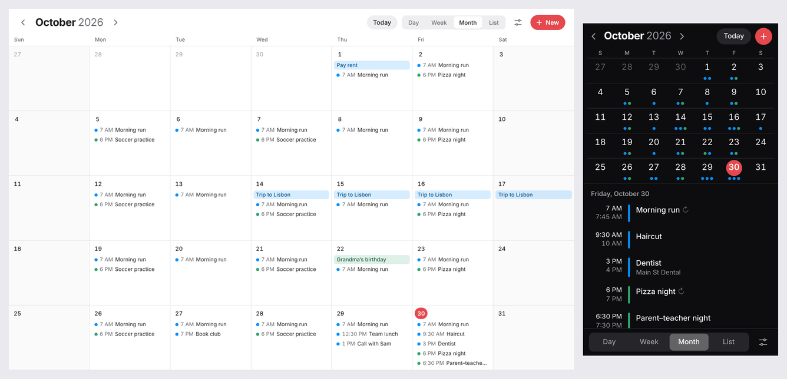

# Calendont

A bloat-free calendar that doesn't invade your privacy or sell you features. Yes it's vibe coded.



- **Private by construction.** No accounts, no servers, no analytics. Your events live in your browser's storage on your device and nowhere else.
- **Installs like an app.** Add it to your iPhone or Android home screen, or install it from Chrome or Edge on a computer. It works offline.
- **One file to back up.** Everything (calendars, events, settings) saves to a single readable `.json` file. Restore it on any device.
- **Speaks .ics.** Import from Apple Calendar, Google Calendar or Outlook. Export a calendar, or send a single event to someone.
- **The calendar basics, done well.** Day, week, month and list views. All-day and multi-day events. Repeats (daily, weekdays, weekly on chosen days, monthly by date or by "last Friday", yearly), with "this event only" and "this and future" edits. Several colour-coded calendars. Search. Light and dark. Undo.
- **No dependencies.** Plain HTML, CSS and JavaScript. Nothing to install, nothing to rot.

## Use it

Open the hosted copy at **https://spathanasf2.github.io/Calendont/**. It's the same code as this repo, served by GitHub Pages.

**On iPhone or iPad:** open that link in Safari, tap **Share**, then **Add to Home Screen**. Do this *before* adding events. The home-screen app and Safari keep separate storage. If you already have events in Safari, back up there and restore inside the app.

**On a computer:** Chrome and Edge show an install icon in the address bar. Safari on macOS has **File → Add to Dock**.

## Run it yourself

You need [Node.js](https://nodejs.org) 20 or newer, and nothing else. There's no `npm install` step.

```bash
git clone https://github.com/spathanasf2/Calendont.git
cd Calendont
npm start
```

Then open http://localhost:8080. No Node? Any static file server pointed at the `app/` folder works too, e.g. `python3 -m http.server 8080 -d app`.

To try it on a phone on the same network, run `HOST=0.0.0.0 npm start` and visit your computer's IP address. Browsers only allow installing and offline mode over HTTPS (or on `localhost`), so for a real install, host it somewhere with HTTPS. A fork with GitHub Pages turned on is the easy way.

## Backups and moving data

Settings has a **Backup & transfer** section:

| | What it is | Use it for |
|---|---|---|
| **Back up everything** | `calendont-backup-YYYY-MM-DD.json` | Safekeeping, moving to a new phone, sharing your whole setup |
| **Restore or import a file** | Takes a backup *or* any `.ics` file | Restoring (replace everything, or merge), importing from other calendar apps |
| **Export all as .ics** | A standard iCalendar file | Opening your events in Apple, Google or Outlook |

Each calendar also has its own export button, and every event has **Send as file**. On a phone this opens the share sheet (AirDrop, Messages, Save to Files). That's how to share events with family, since there's no sync server.

You can also drop a backup or `.ics` file anywhere on the window to import it.

Re-importing the same `.ics` into the same calendar updates the events it brought in, rather than duplicating them.

## What it deliberately doesn't do

- **Sync.** Each device has its own calendar. Share by file, or restore a backup to move everything.
- **Reminders and notifications.** A home-screen web app on iPhone can't schedule alerts by itself. Reliable reminders need a push server, which is exactly what Calendont avoids. This may come later as an optional, self-hosted add-on.
- **Time zones per event.** Times are "floating": 3 PM means 3 PM wherever you are, like a paper calendar. Imported events with time zones are converted to your local time on the way in.

## Keyboard shortcuts

`←` `→` previous/next · `T` today · `D` `W` `M` `L` day, week, month, list · `N` new event · `/` search · `,` settings · double-click a day to add an event there

## Development

```
app/            the whole app — this folder is what gets served
  index.html
  css/app.css
  js/app.js     state, storage and wiring
  js/views/     month, week/day time grid, list
  js/…          editor, settings, import/export, recurrence, dates
  sw.js         offline cache (its asset list is generated)
scripts/        serve.js (local server), stamp.js (refreshes sw.js)
test/           node:test suites for dates, repeats, .ics and backups
```

```bash
npm test          # run the tests (Node's built-in runner)
npm run stamp     # after changing anything in app/ — tests fail until you do
```

`npm run stamp` hashes the app files into `app/sw.js`. A changed hash is how installed copies learn there's an update: they show a "new version ready" prompt.

Pushes to `main` run the tests, then publish `app/` to GitHub Pages (`.github/workflows/pages.yml`). For your own fork, turn it on once under **Settings → Pages → Source: GitHub Actions**.

## License

[MIT](LICENSE)
